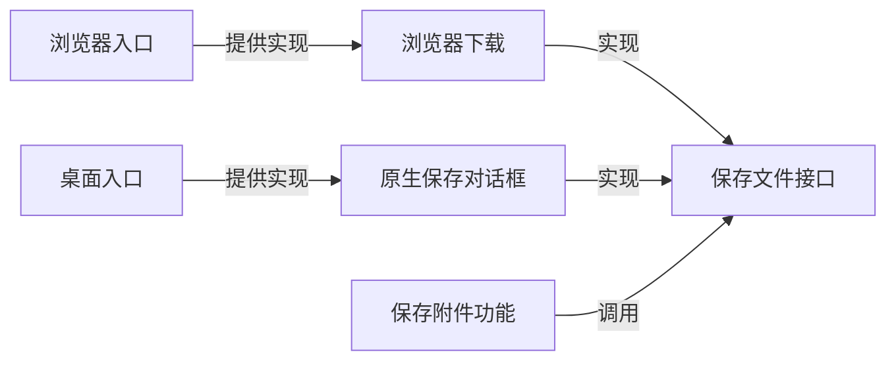

# Moor 明确接口与功能组合彻底改造计划

状态：全量改造完成，自动验收与 GPT-6 Astra Max 独立源码复审通过。源码核对日期：2026-10-02。

当前实现与逐模块职责见[核心架构](core.md)和[模块清单](architecture-modules.md)。四项提交门禁、源码与生产依赖检查、Electron 入口以及合成包内流程均已验证。真实账号、双设备、iPhone/PWA、睡眠恢复及正式签名／公证仍按[设备验收](validation.md)单独核对；此次合成验收不代表这些实机项目通过。

本计划要解决的是：共享业务代码仍在选择浏览器、Electron、HTTP 或具体存储实现，导致同一项功能换一个入口就可能改变行为。改造采用“功能声明所需能力，适配代码实现能力，应用入口完成组装”的方式。

**本计划以全部迁移并删除旧实现为完成条件。** 客户端、Host、Gateway、Worker、CLI、测试和构建入口都必须进入同一套明确接口。分阶段只是实施顺序，不能在第一个切片通过后将剩余改造列为“以后再做”。最终不保留过渡门面、旧导出别名、默认平台兜底或两套业务执行路径。

继续用“功能、能力接口、入口组装”理解结构。包数量不再作为硬约束，也不为每个功能创建包。现有跨入口共用的 Node 私有文件与进程锁实现从协议包移出，集中到一个边界明确的本机状态实现包；其余职责以模块组织。Host、Relay 和各客户端的运行拓扑保持现状。

阅读时可以先看“改造后的协作方式”“最终结构”和“最终完成条件”。其他章节给出全量范围、删除清单、实施顺序和验收细节。本文中的目录和接口定义迁移目标，代码片段用于解释组合方式；阶段是否完成以实际代码与验收结果为准。

## 改造后的协作方式

先用保存附件理解整个方案：

1. 保存附件功能读取附件、校验内容，然后调用保存文件接口。
2. 浏览器适配代码用下载实现接口；桌面适配代码用原生对话框实现接口。
3. 浏览器和桌面各自的启动入口把实现传给功能。



这三种职责分别回答三个问题：

| 职责     | 回答的问题                           | 附件示例                               |
| -------- | ------------------------------------ | -------------------------------------- |
| 功能     | 用户要完成什么事情，需要遵守哪些规则 | 读取、校验并保存当前会话的附件         |
| 能力接口 | 完成这件事，需要外部提供什么         | 读取附件、保存文件、取消尚未完成的保存 |
| 应用入口 | 当前运行环境如何提供这些能力         | 注入浏览器下载或桌面保存实现           |

功能只依赖自己使用的接口；适配代码依赖这些接口及平台 API；应用入口依赖功能与实现。功能模块不能反过来导入适配器，也不能在缺少实现时自行探测环境、创建默认平台实现。

接口按功能实际需要定义。保存附件只接收附件相关能力，审批只接收审批需要的命令和状态能力。避免把所有能力收进一个全局对象，让任何功能都能随时访问文件、登录、传输和存储。

UI 仍可以使用 DOM、响应式布局和 React。执行主机仍需要知道自己承担执行与授权职责。需要移出共享业务的是具体平台选择、物理 URL、数据库对象和传输错误类。纯编码、schema 与文档投影仍作为普通函数使用，完整改造不要求给每个工具函数增加接口。

## 当前源码依据

以下是已经核对的代码结构。表中的改造判断是本计划的建议；它们不等于所有路径都已经复现了用户可见故障。

| 现状                                                                        | 源码依据                                                                                                                                                                                                                                                                                                                                    | 改造方向                                           |
| --------------------------------------------------------------------------- | ------------------------------------------------------------------------------------------------------------------------------------------------------------------------------------------------------------------------------------------------------------------------------------------------------------------------------------------- | -------------------------------------------------- |
| 附件组件读取桌面桥接，判断页面协议，选择下载链接或原生保存                  | [附件视图](../apps/web/src/features/attachments/workspace-attachment-view.tsx)                                                                                                                                                                                                                                                              | 功能只调用保存接口，运行入口选择实现               |
| Google 登录组件探测桌面桥接，编排桥接调用或 HTTP 跳转                       | [Google 登录](../apps/web/src/features/auth/google-login.tsx)                                                                                                                                                                                                                                                                               | 抽出登录流程与平台适配，保留各自确认方式           |
| 工作区存储支持后端注入，但默认创建 IndexedDB 实现；控制器默认创建工作区存储 | [工作区存储](../packages/client/src/operations/workspace/compose.ts)、[控制器](../packages/client/src/features/workspace/compose.ts)                                                                                                                                                                                                        | 由入口创建存储，业务依赖所需的持久化接口           |
| Git、Fork、GitHub、交互和待办等业务模块使用具体 HTTP 错误类                 | [Git 操作](../packages/client/src/features/git/git-workspace.ts)、[Fork](../packages/client/src/features/fork/session-fork.ts)、[GitHub 写入](../packages/client/src/features/github/github-write.ts)、[交互](../packages/client/src/features/interactions/interactions.ts)、[待办](../packages/client/src/features/attention/attention.ts) | 适配层统一错误证据，业务按操作历史决定状态         |
| Web 工作区与 CLI 分别编排原操作送达和恢复                                   | [工作区控制器](../packages/client/src/features/workspace/compose.ts)、[CLI 客户端](../apps/cli/src/client.ts)                                                                                                                                                                                                                               | 共享兼容的原操作规则，各入口保留展示与交互         |
| Host 业务直接使用具体 RuntimeStore；协作服务通过其数据库连接创建状态存储    | [HostWorkspace](../packages/host/src/features/runtime/workspace.ts)、[协作服务](../packages/host/src/features/collaboration/service.ts)、[RuntimeStore](../packages/host/src/adapters/persistence/workspace.ts)                                                                                                                             | 明确提交与存储能力接口，继续由同一主机事务实现     |
| 外观组件直接读取桌面桥接；统一启动入口探测桌面环境                          | [外观组件](../apps/web/src/components/appearance.tsx)、[启动入口](../apps/web/src/app/web-entry.ts)、[桌面构建入口](../electron.vite.config.mjs)                                                                                                                                                                                            | 外观通过明确能力提供；Web 与桌面入口由构建明确选择 |
| Node 私有文件、进程锁和路径校验位于协议包中，并被不同运行入口使用           | [CLI 私有连接](../packages/local-state/src/private-connection.ts)、[进程锁](../packages/local-state/src/exclusive-lock.ts)、[私有路径](../packages/local-state/src/private-project-path.ts)                                                                                                                                                 | 移出协议包，迁移所有 Host、CLI、Relay 及测试消费者 |
| Gateway 的账号、目录和登录编排直接依赖 SQL、Node HTTP 或加密实现            | [账号存储](../packages/gateway/src/features/accounts/service.ts)、[目录](../packages/gateway/src/features/catalog/service.ts)、[Google 登录](../packages/gateway/src/features/auth/google.ts)                                                                                                                                               | 在包内分离业务、受限存储与传输实现，入口统一组装   |

例如，Git 首次拒绝分支识别 `ApiError`，共享工作区请求使用 `WorkspaceRequestError`。从调用链可见，两种错误类没有统一为相同的业务证据；首阶段需要补充当前组装路径的行为回归，再修复此差异。不能把“源码看到分支不一致”写成已经完成真机复现。

现有[包边界检查](../scripts/validation/check-package-boundaries.mjs)约束包依赖和跨包导入。改造还需要包内的功能与适配边界检查，以及完整用户流程验证。

## 最终结构

五个应用入口仍分别负责 Web、桌面、CLI、Host 和 Relay。共享包以真实职责收敛：保留现有六个包，并增加 `@moor/local-state`，只容纳已经被多个 Node 入口使用的私有文件、锁与连接凭据实现。新增包不提供通用远程文件、shell 或 socket 能力。

| 位置                                           | 最终职责                                                       |
| ---------------------------------------------- | -------------------------------------------------------------- |
| `packages/protocol`                            | 纯版本化契约、作用域、响应验证和公共错误语义；移除 `src/node`  |
| `packages/session`                             | 运行位置无关的会话模型、CRDT、快照、增量、编码与文档投影       |
| `packages/client/src/features` 与 `operations` | 唯一的共享客户端业务和原操作规则；只依赖所需能力接口           |
| `packages/client/src/adapters`                 | 按浏览器、Node 与有限 IPC 分类的传输实现；业务不得反向导入     |
| `packages/local-state`                         | Node 私有连接文件、进程锁与安全路径实现，不持有会话业务        |
| `packages/host/src/features`                   | Host 授权、会话、协作、Git、Fork 与恢复用例                    |
| `packages/host/src/adapters`                   | SQL、项目文件、Git、ACP 与外部服务实现，提供 Host 所需能力     |
| `packages/sync`                                | Host 持有的文档状态存储，显式区分纯同步校验与 SQLite 实现      |
| `packages/gateway/src/features` 与 `adapters`  | 账号、目录和转发业务，以及 Node HTTP/WSS、存储、认证和推送实现 |
| `apps/web/src/features` 与 `components`        | 共用 UI、显示状态与用户交互，不承载另一套客户端业务            |
| `apps/web/src/platform`                        | 文件保存、登录、外观、通知、布局偏好及 UI 生命周期适配         |
| 各 `apps/*` 入口                               | 构建时选择入口，创建唯一实例、注入依赖、绑定生命周期和销毁     |

下列目录是最终归属，不是可选候选。实施时每完成一个功能就将它的全部生产与测试消费者迁到唯一入口，并删除对应旧业务路径。

```text
packages/client/src/
  operations/                 原操作状态与恢复规则，以及需要的存储接口
  features/
    sessions/                 提交消息与审批
    attachments/              附件读取校验与保存流程
    auth/                     登录流程状态与能力接口
    workspace/                目录、会话加载与缓存协调
    git/                      Git 原操作业务
    fork/                     Fork 原操作业务
    github/                   GitHub 原操作业务
    collaboration/            持久任务意图与同步协调
    attention/                待办、阅读与后续指令业务
  adapters/
    browser/                  浏览器传输与错误证据转换
    node/                     Node 传输与错误证据转换
    ipc/                      有限 IPC 的传输映射

packages/local-state/src/
  private-connection.ts       本机私有连接文件与认证实现
  exclusive-lock.ts           进程生命周期锁
  private-project-path.ts     私有文件与登记项目的路径隔离

packages/host/src/
  features/                   Host 用例及各自能力接口
  adapters/                   SQL、文件、Git、ACP、外部服务实现

packages/gateway/src/
  features/                   账号、目录、认证和确定的方法转发
  adapters/                   Node HTTP/WSS、SQL、认证和推送实现

packages/sync/src/
  document/                   纯文档编辑与同步校验
  adapters/                   Host 的 SQLite 状态存储

apps/web/src/
  features/                   共享 UI 与显示交互
  platform/
    browser/                  浏览器专有能力实现
    desktop/                  有限 preload API 的渲染器适配
    indexed-storage.ts        IndexedDB 的单一实现
  app/
    web-entry.ts              浏览器入口，只组装浏览器实现
    desktop-entry.ts          桌面入口，只组装桌面实现
    worker-entry.ts           Worker 的独立生命周期组装
```

`client`、`host`、`gateway` 的业务目录不能导入自身或其他包的适配实现、应用源码、Node I/O、Electron 或 React。适配实现依赖接口，组装入口依赖双方。接口放在使用它的功能附近，少量真正共享的原操作规则放在 `operations`。全部生产文件都要归入明确职责，最终不使用“先放这里”的例外名单。

文件、搜索、Skills、通知和外观等所有模块都参与归属检查。业务与验证进入共享功能或纯模型，平台 I/O 进入适配，性能面板、布局呈现与组件状态留在 UI；不以“不是最先发现的例子”为理由保留混合模块。共用 UI 可以继续位于 `apps/web`，包名不授予它处理平台选择的职责。

Web 与桌面使用不同的真实入口。开发、生产、通知 Worker 和打包配置都指向对应入口，不再由共用 `entry.ts` 探测桌面桥接后决定启动方式。桌面桥接缺失时明确失败，不自动退回 Web 路径。外观、剪贴板、布局偏好、项目注册、本机准备状态和通知导航同样通过明确能力与业务状态接入。

共享工作区类型统一采用 `WorkspaceTarget`、`WorkspaceRequest`、`WorkspaceCatalog` 等中性名称。桌面专有上下文只在桌面能力边界出现。移除共享类型的 `DesktopWorkspace*` 旧名称和旧导出别名；`local/remote` 等真实执行路由属性仍保留。数据库名、记录 key 和线上字段不能因为名称整理而改变。

Host 与 Gateway 的具体存储可继续复用现有可靠实现，但只作为受限适配提供能力。唯一组装点负责共享连接和事务，不允许业务绕过接口取得 `db`。`sync` 不依赖 Host 执行用例，Host 的同步适配在组装时检查接口符合性，避免双向包依赖。

公共导出、workspace manifest、依赖锁文件、类型配置、构建入口与许可证一并迁移。只显式导出需要被消费的规范入口，禁止利用通配导出继续暴露内部实现。旧 `client/node/*`、根目录传输入口及 `protocol/node/*` 的消费者改用新规范入口，最终移除旧别名，不维护双份发布面。

## 接口需要表达的行为

### 命令与送达

业务使用已有有限命令及完整执行范围，传输适配负责 HTTP 路径、Cookie、认证头和 IPC。接口必须继续传递账号、设备、工作区、项目、会话与当前连接的约束，并在异步等待后检查原上下文是否仍有效。目标编号不是授权证明。

成功响应仍经过[主机响应验证](../packages/protocol/src/host-response.ts)。HTTP 200、IPC Promise 成功和本地写入完成，都不能替代匹配的主机确认。

错误适配提供统一证据，业务不再检查 `ApiError`、`NodeHttpError` 或 `BrowserHttpError` 的具体类型：

| 证据           | 含义                                         | 业务处理                                       |
| -------------- | -------------------------------------------- | ---------------------------------------------- |
| 本次明确未派发 | 有效拒绝响应，或本地流程可以证明尚未调用派发 | 首次新操作按该功能的拒绝规则结束；保留所需历史 |
| 本次结果未确认 | 断线、响应丢失、响应无法验证或派发后取消等待 | 保留原编号、原输入与范围，等待人工核查         |
| 匹配的主机回执 | 回执与原操作、目标及必要版本一致             | 按协议更新接受状态；接受不等于任务完成         |

**一次重试明确被拒绝，不能证明之前那次请求没有执行。** 统一的是证据和安全规则，不强制 Web、CLI、Git、Fork 等业务使用相同的存储格式、终态名称或清理策略。

适配层不得根据任意 HTTP 状态码推断“未派发”，也不得在后台自动重试普通不确定命令。已退场功能的明确错误语义继续保留。

### 本机存储

存储必须由入口创建，功能只接收所需接口。接口需要保留版本比较、互斥、原子多项写入、明确删除及有效上下文检查，不能退化成任意 `read/write`。

存储层只能报告本机保存事实。主机已经接受但缓存写入失败时，不能改写为“主机未接受”；本机保存了待发送记录时，也不能显示“主机已送达”。

继续使用现有 IndexedDB 数据库名、记录 key、CLI 状态文件、Host 数据库和凭据位置。接口提取不附带数据迁移。存储锁不能因为等待超时而提前释放，造成尚未结束的请求与后续封存操作重叠。

功能需要时间、编号或调度时，接收可替换的最小函数，沿用现有可注入设计。生产入口提供真实实现，测试提供确定时间与触发信号。恢复和重试始终使用保存的原编号，不能借编号生成接口重新创建请求。

### 附件保存

附件功能需要读取、内容验证与文件导出能力。下面的示意接口仅表达保存结果；真实接口还需携带现有附件引用、范围和当前请求生命周期。

```ts
type SaveResult = { status: 'saved' } | { status: 'cancelled' } | { status: 'handed-off' };

interface AttachmentSaver {
  save(file: VerifiedAttachment): Promise<SaveResult>;
  cancel(): Promise<void>;
}
```

浏览器点击下载后只能报告 `handed-off`，即“已交给浏览器下载”；原生文件写入获得确认后才能报告 `saved`。关闭面板或切换会话后，未完成请求不能继续更新新面板，桌面保存需要保留有限取消能力。

组装方式如下，类型和函数名均为示意：

```ts
const attachmentFeature = createAttachmentFeature({
  reader: scopedAttachmentReader,
  saver: browserAttachmentSaver, // 桌面入口提供 desktopAttachmentSaver
});
```

组件调用这个功能，显示结果；不再读取桌面全局桥接或页面协议。原生实现仍通过受限 preload 调用主进程，不向 renderer 暴露文件系统、shell 或 socket。

### 登录

登录接口表达发起、确认、取消以及流程状态。浏览器适配处理受验证的跳转地址；桌面适配处理系统浏览器与确认码；UI 根据流程状态显示操作。

浏览器跳转和桌面确认的差异继续存在。服务端登录流程中的模式字段可能决定安全确认要求，不能把这些字段误当成环境探测而删除。密码、setup token、Cookie 和凭据不进入共享业务快照、CRDT 或持久任务输入。取消、重复确认、过期、账号变化和卸载后的回调都需要明确定义。

### Host 提交与执行

Host 的提交接口以业务事务为单位，而不是为每张表各写一个独立保存方法。会话、元数据、操作凭据，以及要求共同提交的 TaskDoc 和私有执行账本必须在既有原子边界内完成。

用例不接触数据库连接或任意 SQL。事务实现可以提供同一提交单元中的多个受限能力；拆成几个接口不意味着拆成几个事务。外部 Agent 调用、Git 命令和文件副作用仍在数据库事务之外，通过原编号与执行记录处理结果不确定性。

项目访问和 Agent 能力继续由本机受限实现提供。共享请求不能携带可执行命令、环境变量或任意路径，Host 仍复核登记项目、当前授权和精确活动回合。

## 功能迁移范围

| 功能                             | 共享业务范围                                   | 入口或适配器保留的内容                         |
| -------------------------------- | ---------------------------------------------- | ---------------------------------------------- |
| 会话提交、审批、问题回答、介入   | 校验当前回合、冻结输入、构造有限意图、核对回执 | 表单、快捷键、CLI 输入输出、传输               |
| Git、Fork、GitHub 写入           | 各自的前置检查、原操作、核查和人工重试规则     | URL 映射、HTTP 错误转换、UI 展示               |
| 工作区与会话读取                 | 身份范围、目录和会话版本、失效通知、缓存协调   | Web 事件、桌面事件、页面可见性和持久实现       |
| 附件、文件、历史 diff、搜索      | 引用、范围、版本与内容验证                     | 文件选择、原生保存、下载、预览和布局           |
| 登录、账号与能力配置             | 流程状态、当前账号失效、允许执行的动作         | 跳转、系统浏览器、本机设置与凭据               |
| 持久任务与协作                   | 冻结意图、持久记录、同步与 offer 协调          | 本机存储与连接实现；Host 保留执行受理权        |
| 待办、通知、Skills 与运行选项    | 适合复用的业务状态和输入规则                   | 推送、通知 API、焦点事件、命令选择和组件状态   |
| 外观、布局偏好、剪贴板与项目注册 | 状态、允许的动作、有效范围与保存结果           | 系统主题、存储、复制、原生目录选择与窗口事件   |
| 通知 Worker 与协作独立页面       | 同一套任务、账号、缓存与通知业务               | 各自的存储实例、事件来源和销毁生命周期         |
| Host 全部执行与恢复功能          | 授权、接受、去重、队列、活动回合和核查政策     | SQLite、项目文件、Git、ACP、外部服务和通知派发 |
| Gateway 账号、目录、授权与路由   | 认证流程、授权复核、目录一致性和确定的方法派发 | Node HTTP/WSS、SQL、密码与凭据实现、OIDC、推送 |
| 构建、测试与发布                 | 真实入口、规范导出、依赖边界和行为验证         | Vite、esbuild、打包、许可及 CI 执行环境        |

持久任务的恢复与普通原操作的恢复保持各自策略。当前已退场的预览、逐回合 MCP、旧角色和父子任务只保留必要历史读取与核查路径，不借重构恢复执行。

## 必须删除或替换的旧路径

这张表是最终删除核对表。实现可以跨阶段进行，但每项必须有明确的新归属和全部消费者迁移结果；不能只新增一层包装后勾选完成。

| 旧路径或机制                                                   | 最终处理                                                             | 完成证据                                                     |
| -------------------------------------------------------------- | -------------------------------------------------------------------- | ------------------------------------------------------------ |
| `WorkspaceController` 中集中的全部业务编排                     | 分解到工作区、会话、操作、协作等功能；删除旧类与导出，不保留委托门面 | UI、CLI、Worker 和测试都使用规范功能接口                     |
| `WorkspaceStore` 同时承载大量功能模型、记录与平台默认值        | 分离各功能持久模型和受限存储能力；移除旧聚合入口                     | 旧记录可读取，业务不存在 IndexedDB 默认构造                  |
| Web、CLI、各面板分别维护的送达与恢复判断                       | 全部接入唯一证据与共享原操作规则；各功能政策显式保留                 | 对相同合成故障进行跨入口行为验证                             |
| 业务中的 `instanceof ApiError/NodeHttpError/BrowserHttpError`  | 移到所属适配器，业务只使用统一证据                                   | 全部共享业务目录无具体传输错误类依赖                         |
| 功能中的 `request(path, body)` 与 HTTP 路径拼接                | 使用有限业务命令与范围；真实路径仅在传输映射存在                     | 全部功能消费者不再提供任意 URL 调用能力                      |
| UI 与功能中的桌面桥接探测，包括外观、附件、登录                | 改为显式能力接口；原生桥接只在桌面适配和入口访问                     | 同一 UI 可使用浏览器或桌面能力而无需分支                     |
| 共用 `entry.ts` 自动探测环境，或桌面失败回退到浏览器           | 独立 Web、桌面与 Worker 入口；开发和正式构建同时切换                 | 构建图确认入口，缺失桌面能力按原生入口明确失败               |
| 共享 `DesktopWorkspace*` 类型与旧模块导出                      | 重命名为中性共享类型，桌面专有类型归平台；删除旧别名                 | 生产与测试无旧共享名称和导入路径                             |
| `protocol/src/node`                                            | 移到 `local-state`；私有凭据格式仍保持私有                           | Host、CLI、Relay、客户端 Node 适配和测试全部迁移，旧目录删除 |
| Host 业务持有 `RuntimeStore`、`journal.db` 或任意 SQL          | 业务依赖受限提交、查询及 Agent 接口；具体实现只在适配与组装使用      | 业务依赖检查与同事务故障验证同时通过                         |
| Gateway 业务直接接触 `IncomingMessage`、SQL、Cookie 与加密实现 | 受限账号、目录、认证、转发接口与 Node 适配分离                       | 无平台类型进入业务 API，Host 与 Relay 入口共用新组装         |
| 旧公共子路径、CLI 专有错误类型放在共享业务层                   | 只保留规范导出；CLI 输出与退出码类型归 CLI                           | manifest、所有调用方和构建入口同步迁移，无 re-export 旧别名  |
| 仅为旧实现保留的测试、fixture、构建 alias 与文档               | 有价值的断言迁到新接口，删除旧实现依赖并更新指向                     | 未使用代码与生产可达性检查通过，文档链接无旧失效目标         |

旧代码的类名和文件名不是必须全部消灭的字符串。可靠的 SQL、Git 或 ACP 实现可以迁到其规范适配位置继续使用；必须删除的是旧业务入口、重复规则、反向依赖和过渡别名，不能把这些机制换个名字后保留。

## 实施顺序

### 第一阶段 固定最终接口并迁移共同基础

对全部生产源码、导出、真实调用方、测试、Worker、构建配置和文档建立迁移清单。每个现有模块都要有最终职责、规范入口、所有消费者和删除条件，清单必须与实际生产文件集合核对；没有归属的文件阻止总体验收。

明确完整作用域、统一错误证据、互斥与原子存储、异步生命周期、时间与编号能力。通过当前组装路径验证首次拒绝、响应丢失、拒绝重试等基线，不能只注入旧错误类来证明新业务正确。

建立 `local-state` 并一次迁移全部跨入口消费者；移出协议中的 Node I/O。同步更新 workspace 依赖表、manifest、类型配置、规范导出和构建规则，这是最终依赖图的变更，不设置临时豁免。迁移传输到规范适配目录，删除旧子路径导出。规范共享工作区类型，同时更新主进程、preload、renderer、CLI、Worker、测试和构建。

完成条件：共同基础没有双入口或遗留别名，线上字段和私有数据格式保持兼容，所有消费方编译与对应流程通过。

### 第二阶段 完成全部平台能力与入口组装

迁移附件、登录、账号、外观、布局偏好、剪贴板、项目注册、通知与窗口生命周期。将纯业务、UI 和平台 I/O 分配到各自最终位置，把 `StorageBackend` 契约与 IndexedDB 实现完全分开。

Web、桌面、协作独立页面、通知 Worker 和 CLI 显式创建各自实例。更新开发、正式构建和打包入口，取消自动环境探测和默认平台兜底。身份变化时释放旧订阅、未完成请求和缓存上下文。

每个功能的实现与消费者在本阶段一起切换，删除其旧探测函数和旧组装代码，不留下“先保留旧 UI 调用”的门面。

完成条件：全部 UI 能力通过接口取得，登录确认、原生取消、下载交接、外观同步、账号切换、跨页面存储与刷新恢复通过；旧组装路径不存在。

### 第三阶段 完成全部共享客户端业务

迁移消息提交、审批、问题回答、介入、Git、Fork、GitHub、待办与运行选项的完整规则。Web、桌面、CLI 共用证据与原操作状态转换，业务政策和展示差异通过明确接口表达。

迁移目录、会话加载、内容、搜索、Skills、持久任务、文档同步和缓存协调。维持当前增量副本、引用复用、缓存预算与调度行为；组件只持有视图状态和它需要的动作接口。

完成全部调用方后删除 `WorkspaceController`、旧聚合存储及各功能的旧业务实现。视图可以聚合功能的状态，但不能重新生成一个改名后的万能控制器、全局服务对象或第二套恢复流程。

完成条件：全部客户端业务、UI、CLI、独立页面、Worker 和测试使用唯一规范接口；普通原操作、持久任务和草稿分别保持正确恢复政策；当前源码依据中列出的业务泄漏全部清零。

### 第四阶段 完成 Host 同步与 Gateway 的接口组合

Host 的会话、原操作、审批、协作、Git、Fork、项目文件、搜索、配置、通知和外部服务全部按用例与能力整理。具体 RuntimeStore、SQL、文件和 ACP 实现移入适配位置；共享事务实现由唯一组装点管理，业务不再持有数据库对象。

整理 `sync` 的纯校验与 SQL 实现，由 Host 组装接入既有原子边界。初始化、迁移、恢复和执行器激活有独立生命周期，读取继续只读。同步模块不能反向依赖执行业务，避免循环。

Gateway 同步整理账号、目录、登录、通知与有限派发，把 Node HTTP/WSS、Cookie、SQL、凭据和外部提供者实现放到适配。Host 本机入口与 Relay 入口全部使用新组装，不为本机服务另留旧 Gateway 工厂。

完成条件：Host、同步与 Gateway 无旧业务旁路；事务失败不派发；重复意图不重复执行；读取不创建状态或启动队列；授权、原范围和异步复核得到完整保留。

### 第五阶段 删除全部过渡内容并完成整体验收

逐项关闭删除核对表与全量模块清单，迁移测试引用、公共导出、构建配置和所有受影响文档。过渡代码只可存在于未结束的迁移工作中，最终仓库不能有转发旧类的门面、deprecated 别名、新旧双路由、平台默认兜底或此次迁移的临时 TODO。

将包内规则加入持续检查：业务不能导入适配和平台 I/O；共享 UI 不能探测桥接；协议无 Node 实现；入口与适配权限按职责配置。不得用单个旧文件或旧目录的豁免保住违反规则的代码。

同时检查类型依赖图、静态与动态导入、实际构建产物、复制资源与发布许可证。测试通过不代替生产可达性，生产源码没有旧引用也不代表打包 alias 和复制资源已经清理。

完成条件：下一节所有最终完成条件成立；所有门禁和完整用户流程通过；只要存在未迁移模块或旧路径，整个改造仍是未完成。

## 最终完成条件

以下条件共同成立，才可以将改造标记为完成。单个功能或阶段通过，不等于整个计划完成。

- 全量生产模块有唯一职责与规范入口，生产消费者、测试、Worker、独立页面、构建与文档全部迁移，没有剩余模块等待后续整理。
- 旧业务控制器、聚合存储门面、共享工作区旧名称、旧子路径、导出别名及过渡兼容包装全部移除；可靠的底层实现只以最终适配职责存在。
- 业务目录中没有桌面桥接、运行平台探测、具体传输错误、任意 HTTP 路径、隐式 IndexedDB 构造或数据库对象依赖；规则持续检查且无迁移豁免。
- Web、桌面、Worker 与 CLI 明确组装自己的能力，开发、生产和打包使用同一套规范入口；缺失能力明确失败，没有自动换平台路径。
- 同一业务只存在一个规则来源，送达、审批、持久任务与恢复在各消费者之间一致，未出现改名后的万能控制器。
- Host 的原子提交、执行去重、当前授权和精确回合审批保持成立；Gateway 与 Relay 不获得正文持久层或执行权。
- 现有文档、数据库、凭据与原操作可读取和核查；旧格式通过明确版本边界处理，未保留另一套应用或执行引擎。
- 旧实现测试和 fixture 迁移或删除，源码消费者、生产构建图、资源、许可与分发白名单均核对，全部要求的检查通过。
- 此次迁移没有“暂时保留”“稍后迁移”的实现或 TODO；未验证的真实设备范围按事实列出，不以合成结果声称真机通过。

## 数据兼容与实施回退

本次完整改造不改变线上报文和持久格式，保持原操作编号、请求正文指纹、数据库路径、记录 key、凭据位置和格式版本。源码名称、公共导出和依赖结构彻底迁移；持久数据和已发布报文通过明确的版本解析边界接入同一套业务接口。

必要的旧格式读取和退场操作核查属于当前产品的数据兼容职责。它们只保留被现有数据和支持政策需要的解析、只读与原编号核查能力，不创建旧客户端、旧队列或另一套执行引擎。接口、存储格式和执行授权三者分别核对，不能为了删除“legacy”字样丢弃用户数据，也不能借数据兼容留下旧业务门面。

迁移中可短期使用过渡委托帮助切换消费者，但它只调用新实现，不同时执行新旧实现；所属阶段结束时必须删除。生产和测试消费者完成迁移后，旧模块导出与别名一并移除。长期保留的版本解析使用明确的版本契约和规范路径，不伪装成旧 API 的重导出。

实施期间回退到上一份完整代码时，仍须读取本阶段写入的数据和原操作。回退使用完整源码、构建与依赖图，不在最终代码里保留一个可切回旧业务引擎的开关。不得通过删除数据库、任务记录或凭据完成回退。

若具体迁移暴露出无法保持线上或持久格式的问题，该阶段保持未完成，先调整接口与适配并重新验证；不得将破坏兼容的改动夹在重构中发布，或把补齐兼容列为完成后的 TODO。

依赖版本保持锁定。构建仍按实际消费者引入资源与第三方许可，浏览器产物不引入 Host 或 ACP 实现，Relay 不获得会话持久层；重打包继续保留 operator 数据。

## 自动化验收

以构建后的客户端、Host 和 Relay 的用户流程为主。浏览器、桌面 renderer 和 CLI 复用相同的合成 Host 行为与确定的故障信号；不要用真实 Agent 账号、真实外部写入或固定 sleep。

| 用户流程或故障                   | 必须观察到的结果                                                           |
| -------------------------------- | -------------------------------------------------------------------------- |
| 浏览器与桌面保存同一附件         | 内容验证正确，保存或下载结果如实表达；切换会话后的迟到结果不污染新面板     |
| 取消原生保存或关闭面板           | 有限取消生效，不把取消显示为保存成功                                       |
| Google 发起、确认、取消与过期    | 各端保留原确认要求；重复确认、账号变化和卸载回调不会继续旧流程             |
| 草稿保存后刷新、并发页面编辑     | 数据可恢复，互斥与版本冲突生效，不自动发送普通草稿                         |
| 同一新操作首次明确拒绝           | Web、桌面、CLI 与各功能遵守一致证据规则，按各自业务政策结束或保留记录      |
| 已派发请求断线，再手动核查或重试 | 使用原编号、原输入与原范围；拒绝重试不覆盖先前的不确定结果                 |
| 主机接受成功，本机缓存提交失败   | 显示主机接受与缓存失败两个独立事实，后续缓存可补齐                         |
| 切换账号、设备、项目、会话或连接 | 旧订阅、响应、权限请求与原操作不能绑定到新上下文                           |
| 审批迟到、回合改变或重复响应     | 只允许匹配当前回合及请求的授权，旧响应被拒绝                               |
| 离线明确提交持久任务后重连       | 冻结输入和授权按既有策略同步入队，同编号不同输入被拒绝，重复送达只执行一次 |
| Host 提交失败或进程恢复          | 失败提交不派发，已派发或未知结果不自动重放，普通读取不启动执行             |
| 长历史、流式回复与快速切换       | 保留增量导入、对象引用复用、缓存预算和导航行为，无持续增长的旧副本或订阅   |

优先扩展[构建后 CLI 流程](../tests/e2e/cli-host.test.ts)、[浏览器工作区流程](../tests/e2e/browser-workspace.cjs)和[renderer 场景入口](../tests/e2e/renderer.test.ts)。不会为了“统一流程”让 CLI 承担文件对话框等它当前没有的 UI 能力。

原生文件对话框、跨页面存储故障、精确审批竞争和事务失败等难以稳定通过完整流程覆盖的边界，保留聚焦集成测试。可参考[附件保存](../tests/integration/desktop-attachment-save.test.ts)、[Google 桌面登录](../tests/integration/desktop-google-auth.test.ts)、[操作恢复](../tests/integration/workspace-operation-recovery-relay.test.ts)、[会话意图](../tests/integration/session-intents.test.ts)和[工作区缓存](../tests/integration/workspace-session-cache.test.ts)。测试断言行为，不只检查函数调用顺序或源码字符串。

实施时按修改范围先跑对应流程。每个准备提交的阶段运行仓库要求的门禁：

```sh
pnpm check
pnpm test
pnpm build
pnpm format:check
```

第五阶段另外核对 `pnpm knip`、`pnpm knip:production` 与 `pnpm production:check`。涉及 Electron 加载、preload 或构建时，运行 `pnpm check:desktop:electron`；涉及分发产物时，按[开发与验证](development.md)核对包内路径、许可与数据白名单。

完成全量迁移和自动化验收后，必须由 `gpt-6-astra`、`max` 进行独立源码审查，判断是否符合 Hexagonal Architecture / Ports & Adapters。审查覆盖业务对外部实现的依赖方向、消费方接口归属、有限能力、事务边界、各入口装配和旧路径清理，并提供可定位的源码依据。发现不符合项时继续修改、验收和复审；只有复审通过，才能提交最终代码并完成 Goal。阶段提交仍须先通过四项仓库门禁。

最终同时核对全量模块清单、上文删除表、manifest 导出、静态与动态依赖、构建 alias、Worker 与正式产物。核查对象包括生产和测试代码；不得只搜索业务目录中的旧名字，遗漏另一个工厂、fixture 或复制到分发包的旧资源。结构检查是行为验收之外的门禁，不写只复述源码字符串的测试来代替真实流程。

这些合成检查不证明真实账号登录、原生对话框实机交互、双设备同步、iPhone/PWA、睡眠恢复或正式发布通过。对应真机结果按[设备验收](validation.md)单独记录。本文仅提出实施验收要求，没有声称这些行为检查已经运行。

## 需要检查的设计取舍

1. **最终只存在一套业务路径。** 全量迁移全部消费者，不保留旧控制器、别名、兜底、双实现和临时豁免。
2. **用三种职责理解结构。** 功能、能力接口和入口组装贯穿客户端、Host、同步与 Gateway；以模块组织功能，跨入口共用的 Node 私有状态单独隔离。
3. **共用业务与运行入口分开。** Web、桌面、CLI、Worker 和独立页面调用规范功能接口，明确选择实现，共用 UI 可以继续位于 apps/web。
4. **Host 与 Gateway 也必须完成。** Host 事务保持集中，Gateway 保持授权与转发职责，不以客户端已经改好为整体完成。
5. **数据兼容不保留旧业务引擎。** 同一套接口承接必要旧格式与原操作核查，草稿、普通不确定命令、明确提交任务保持各自恢复政策。
6. **全部最终条件是交付门槛。** 分阶段便于实施，每项删除、完整用户流程、生产构建与依赖检查必须共同通过。

评审时重点检查：全部模块是否都有最终归属；接口是否表达失败、取消、确认与持久化；所有消费者与构建入口是否切到唯一规范入口；需要删除的东西是否有可核对条件；数据兼容是否真正走同一套业务接口；整体完成标准是否允许任何尚未迁移的尾项。

全量模块职责和规范入口见 [模块清单](architecture-modules.md)。

相关依据：[核心架构](core.md)、[接口语义](interface-semantics.md)、[会话业务意图](session-intents.md)、[开发与验证](development.md)。本计划作为完整代码迁移与验收依据，当前产品承诺仍以[能力表](capabilities.md)为准。
